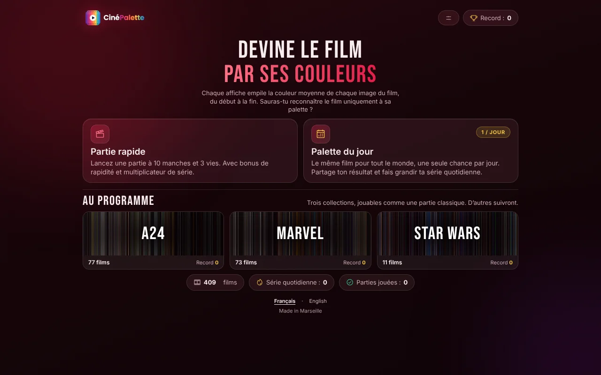

# CinéPalette

**Devine le film par ses couleurs.** Chaque palette empile la couleur moyenne de
chaque image d'un film, du premier plan au dernier. À toi de reconnaître le film
parmi trois propositions.

🎬 Jouer : [cinepalette.visuneo.fr](https://cinepalette.visuneo.fr)



## Fonctionnalités

- **Partie rapide** : 10 manches, 3 vies, bonus de rapidité et multiplicateur de série.
- **Palette du jour** : le même film pour tout le monde, une chance par jour, résultat à partager.
- **Collections** jouables (A24, Marvel, Star Wars) et trois niveaux de difficulté,
  fondés sur la proximité des palettes entre elles.
- 409 films, interface en français et en anglais, installable comme application (PWA).
- Aucun compte, aucun traceur : records et séries restent dans le `localStorage` du navigateur.

## Stack

- JavaScript vanilla (modules ES), HTML et CSS, sans framework
- [Vite](https://vite.dev) pour le serveur de dev et le build
- [Vitest](https://vitest.dev) pour les tests
- Python 3 (Pillow, NumPy) et ffmpeg pour les outils d'ajout de films (facultatif)
- GitHub Actions pour l'intégration continue (tests, build, `npm audit`)

## Lancer le projet en local

Prérequis : Node.js 20 ou plus récent (la CI tourne sur Node 24).

```bash
git clone https://github.com/2lattes/CinePalette-public.git
cd CinePalette-public
npm ci            # installe les dépendances (respecte package-lock.json)
npm run dev       # serveur de dev avec rechargement à chaud → http://localhost:5173
```

Autres commandes :

```bash
npm test          # contrôle des données FR/EN puis tests Vitest
npm run build     # build de production → dist/
npm run preview   # sert le build de production en local
```

Le projet n'utilise aucune variable d'environnement ni clé d'API : il n'y a pas
de fichier `.env` à créer.

## Architecture

Une architecture en couches, où les dépendances vont vers l'intérieur.

```
index.html · en.html   Pages par langue : balisage statique uniquement.
public/                Ressources copiées telles quelles (palettes WebP, icônes, manifeste PWA).
design/                Sources de la marque, non servies.
src/
├── app.js             Point d'entrée : charge le bundle de la langue de la page.
├── controller.js      Orchestration : moteur de jeu ↔ services ↔ vues.
├── config.js          Réglages du jeu (objet gelé).
├── core/              Logique pure, sans DOM : moteur, score, distracteurs, RNG, date.
├── data/              Catalogue des films (titres fr/en).
├── i18n/              Textes de l'interface, en français et en anglais.
├── services/          localStorage et presse-papiers, derrière de petites façades.
├── styles/            Tokens → base → layout → composants → responsive.
└── ui/                Vues : les seuls modules qui touchent au DOM.
scripts/               Contrôle des données et outils d'ajout de films.
```

La palette du jour est déterministe : un générateur pseudo-aléatoire semé par la
date choisit le film, les mauvaises réponses et leur ordre. Un test « d'or »
(`src/core/__tests__/daily.golden.test.js`) fige ce tirage sur 400 dates.
Les règles à ne pas casser sont détaillées dans [AGENTS.md](AGENTS.md).

## Ajouter des films

```bash
python3 scripts/add-films.py --template > nouveaux-films.csv   # à remplir
python3 scripts/add-films.py nouveaux-films.csv
```

Le script calcule la palette depuis le fichier vidéo, ajoute les films aux deux
langues et recalcule les voisins de couleur. Voir [ADDING-FILMS.md](ADDING-FILMS.md).

## Crédits

Les palettes de films ne sont pas mon travail. Elles proviennent de deux projets
que je remercie :

- [**The Colors of Motion**](http://thecolorsofmotion.com/), de Charlie Clark
  (257 palettes) ;
- [**Color of Cinema**](https://www.colorofcinema.com/) (152 palettes).

La source de chaque palette est indiquée dans `catalogue.csv` (colonne `source`).
CinéPalette est un projet personnel, gratuit et sans publicité. Si vous êtes
l'auteur de l'un de ces projets et souhaitez qu'une palette soit retirée ou que
le crédit soit modifié, ouvrez une *issue*.

Les titres de films, les noms de studios et de franchises appartiennent à leurs
détenteurs respectifs. Les images de la salle de cinéma ont été générées par IA.
Polices : [Inter](https://github.com/rsms/inter) et Bebas Neue, sous licence
SIL Open Font License (fichiers dans `src/assets/fonts/`).

## Licence

Le code source est publié sous [licence MIT](LICENSE).
Cette licence ne couvre pas les palettes de films (voir « Crédits »).

---

Fait à Marseille par Antoine Delatouche · [Visuneo](https://visuneo.fr)
